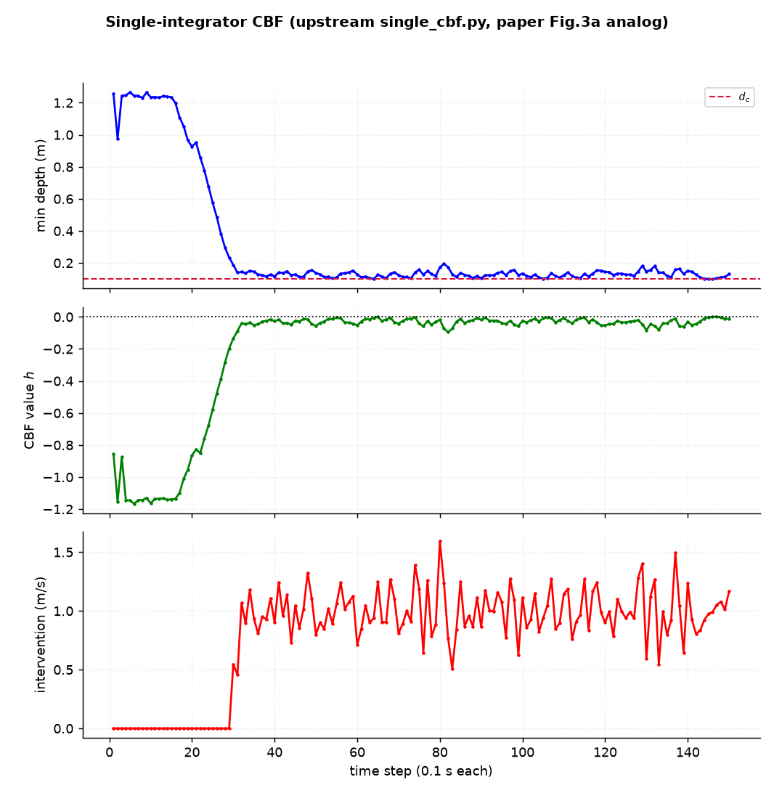
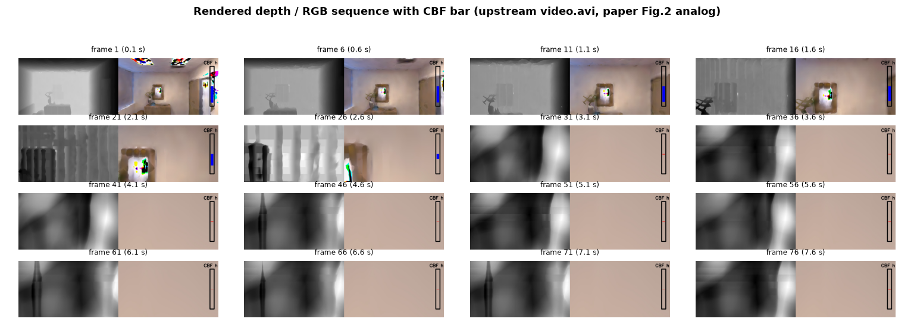
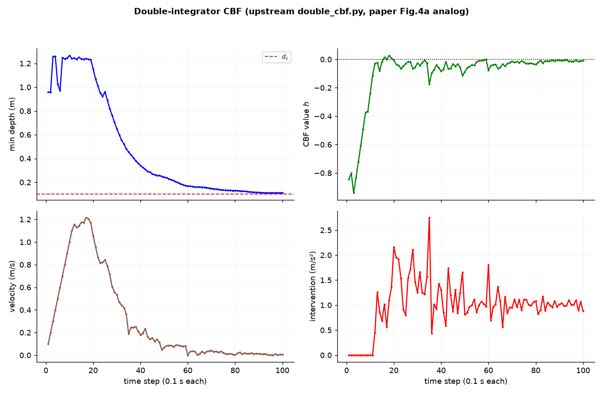

# CBF + NeRF 视觉安全滤波器 · 论文结果复现

复现 **Tong, Dawson, Fan, "Enforcing Safety for Vision-based Controllers via Control Barrier Functions and Neural Radiance Fields", ICRA 2023**（[arXiv:2209.12266](https://arxiv.org/abs/2209.12266)）的仿真实验。

`upstream/` 与论文作者公开代码（[oscartong2001/nerf_cbf_controller](https://github.com/oscartong2001/nerf_cbf_controller)，commit `a514356`）**逐字节一致**，唯一例外是 `single_cbf.py` 中 `cv2.VideoWriter` 的一处尺寸修正（见[运行说明](#运行说明)）。回放、出图、参数扫描等全部放在 `tools/` 下的新增脚本里，不修改上游文件。

---

## 仓库结构

```text
upstream/                     论文作者公开代码(未修改)
├── single_cbf.py             单积分器实验(图 2 / 图 3a)
├── double_cbf.py             双积分器实验(图 4a)
├── run.py, visualizer.py
├── src/                      NICE-SLAM 实现(渲染器 / 解码器 / 数据集)
├── configs/Replica/room1.yaml
├── replica_room1.npy         ┐
├── replica_room1.pth         │ 作者发布的 Room1 训练成果
├── pretrained/coarse.pt      │ (共约 150 MB)
├── pretrained/middle_fine.pt ┘
├── device.txt, environment.yaml, LICENSE, README.md
tools/
├── make_dataset_stub.py      生成 1 帧占位数据集(见运行说明)
├── plot_from_log.py          解析上游日志 → 图 3a / 图 4a
├── frames_from_video.py      从 video.avi 抽帧 → 图 2 的 RGBd 序列
└── sweep_upstream.py         参数扫描 → 图 5(外挂驱动,不改上游)
run_upstream.ps1 / .sh        一键运行(Windows / Linux)
logs/                         上游脚本的原始日志
results/figures/              生成的图与指标 CSV
docs/                         讲义、论文翻译、PyCharm 指南、CUDA 笔记
```

---

## 环境要求

- Python ≥ 3.9，PyTorch（CUDA 版），OpenCV，numpy，scipy，matplotlib
- NVIDIA GPU（推荐）。本仓库实测环境：RTX 5070 Laptop 8 GB / torch 2.11.0+cu128 / CUDA 12.8 / Windows 11

```bash
pip install torch --index-url https://download.pytorch.org/whl/cu128   # 按显卡选择 wheel 源
pip install numpy==1.26.4 scipy matplotlib opencv-python
```

---

## 快速开始

```bash
# 1) 生成数据集占位(只需一次;上游只用第 0 帧做形状校验)
python tools/make_dataset_stub.py

# 2) 运行两个实验(与上游 README 的命令完全相同,只是需要设一个环境变量)
#    Windows
powershell -ExecutionPolicy Bypass -File run_upstream.ps1 -Which all
#    Linux / macOS
bash run_upstream.sh all
#    或者手工执行:
#    export TORCH_FORCE_NO_WEIGHTS_ONLY_LOAD=1
#    cd upstream && python -u single_cbf.py configs/Replica/room1.yaml --output output/Replica/room1

# 3) 出图
python tools/plot_from_log.py logs/single_upstream.log logs/double_upstream.log --csv
python tools/frames_from_video.py upstream/video.avi
```

耗时（RTX 5070 Laptop）：单积分器 150 帧约 20 分钟，双积分器 100 步约 14 分钟。大部分时间花在上游每帧一次的 1200×680 两趟渲染（约 7 s/帧）。

---

## 复现结果

| 论文结果 | 产物 | 说明 |
|---|---|---|
| 图 2 RGBd 帧序列（每 0.5 s 一张，右侧 CBF 指示条） | `upstream/video.avi`（150 帧，2400×680）、`results/figures/figure2_frames.png` | 上游每帧把「深度图 + RGB + 指示条」横向拼接写入 |
| 图 3a 单积分器：最小距离 / CBF 值 / 干预量 | `results/figures/figure3a_single.png`、`single_metrics.csv` | 由 `logs/single_upstream.log` 解析 |
| 图 4a 双积分器：最小距离 / CBF 值 / 速度 / 干预量 | `results/figures/figure4a_double.png`、`double_metrics.csv` | 由 `logs/double_upstream.log` 解析 |
| 图 5 参数扫描 | `results/figures/figure5_sweep.png` | `tools/sweep_upstream.py` 已提供，单次全扫约 70 分钟；本次未执行该扫描 |
| 图 3b / 4b：与 NeRF-Navigation 的对比 | — | 对比方法未公开代码，未复现 |
| 图 6 密度型 CBF 消融 | — | 公开仓库不含对应脚本，未复现 |

### 单积分器（`single_cbf.py`，150 帧 = 15 s 仿真）

| 量 | 值 |
|---|---|
| 初始最近距离 | 0.9569 m |
| 首次干预 | 第 30 帧，距墙 0.1885 m |
| 最小距离 | 0.0987 m（第 146 帧） |
| 末帧最近距离 | 0.1305 m |
| CBF 值 `h` 最大值 | +0.0013（150 步中有 2 步为正） |
| 干预量 | 121/150 步非零，均值 0.799，峰值 1.593 m/s |





### 双积分器（`double_cbf.py`，100 步 = 10 s 仿真）

| 量 | 值 |
|---|---|
| 初始最近距离 | 0.9588 m |
| 首次干预 | 第 12 步，距墙 1.2445 m |
| 最小距离 | 0.1099 m（第 96 步） |
| 末帧最近距离 | 0.1108 m |
| CBF 值 `h` 最大值 | +0.0274（100 步中有 3 步为正） |
| 速度 | 峰值 1.216 m/s → 终值 0.007 m/s |
| 干预量 | 89/100 步非零，均值 0.999，峰值 2.750 m/s² |
| 单步耗时（含高分辨率测量渲染） | 均值 0.149 s，峰值 0.302 s |



---

## 运行说明

上游命令本身可以照抄，但有三处环境层面的差别，均**不涉及算法**：

1. **环境变量 `TORCH_FORCE_NO_WEIGHTS_ONLY_LOAD=1`**
   torch ≥ 2.6 把 `torch.load` 的默认参数 `weights_only` 由 `False` 改为 `True`。上游会加载三个整体 pickle 的对象（`replica_room1.pth` 是 `nn.Module`、`pretrained/*.pt` 是含模型字典的 dict），在新默认值下直接抛出 `UnpicklingError`。设置该环境变量即可在**不修改上游任何代码**的前提下恢复旧行为。已在 torch 2.11 上验证。

2. **数据集占位目录**
   上游 `NICE_SLAM.__init__` 会读取 `Datasets/Replica/room1`（颜色图、深度图、`traj.txt`），但两个实验脚本只用 `frame_reader[0]` 做一次形状校验，其数值不参与任何计算——场景信息全部来自作者发布的神经隐式地图权重。`tools/make_dataset_stub.py` 生成一个 1 帧的最小目录供启动校验使用。若需要与作者环境完全一致，把完整 Replica `room1` 放到同一路径即可，实验数值不变。

3. **`upstream/single_cbf.py` 第 199 行（唯一代码改动）**

   ```diff
   -    videoWriter = cv2.VideoWriter('video.avi',fourcc,fps,(240,68))
   +    videoWriter = cv2.VideoWriter('video.avi',fourcc,fps,(2400,680))
   ```

   上游以 `(240,68)` 创建写入器，而实际帧为 1200×680 左右拼接后的 2400×680，OpenCV 会静默丢弃所有帧，`video.avi` 只剩 5.7 KB 文件头。修正后视频为正常的 150 帧、5.3 MB。

`double_cbf.py` 中视频写入的两行在上游即被注释掉，因此双积分器实验只产生日志，无视频。

---

## 文档

| 文档 | 内容 |
|---|---|
| [`docs/02_学习路线与讲义.md`](docs/02_学习路线与讲义.md) | 讲义：从单/双积分器、刚体运动、CBF 与离散时间条件，到体渲染与实验方法；含定义、代码位置、算例与练习 |
| [`docs/03_论文翻译与注释.md`](docs/03_论文翻译与注释.md) | 论文逐段翻译与公式详解 |
| [`docs/04_实现代码与CUDA_学习笔记.md`](docs/04_实现代码与CUDA_学习笔记.md) | CUDA 执行模型、PyTorch 算子与硬件的对应、渲染算法逐层拆解、修改实践 |
| [`docs/05_PyCharm运行指南.md`](docs/05_PyCharm运行指南.md) | 在 PyCharm 中配置解释器、环境变量、工作目录与运行配置，含错误对照表 |
| [`docs/paper_ICRA2023_CBF_NeRF.pdf`](docs/paper_ICRA2023_CBF_NeRF.pdf) | 论文原文 |

---

## 引用

```bibtex
@inproceedings{tong2023enforcing,
  title     = {Enforcing Safety for Vision-based Controllers via Control Barrier
               Functions and Neural Radiance Fields},
  author    = {Tong, Mukun and Dawson, Charles and Fan, Chuchu},
  booktitle = {IEEE International Conference on Robotics and Automation (ICRA)},
  year      = {2023}
}
```

上游代码：[oscartong2001/nerf_cbf_controller](https://github.com/oscartong2001/nerf_cbf_controller)（Apache-2.0）·
其上游：[cvg/nice-slam](https://github.com/cvg/nice-slam)（Apache-2.0）。

## License

Apache License 2.0 —— 见 [`LICENSE`](LICENSE) 与 [`NOTICE`](NOTICE)。
