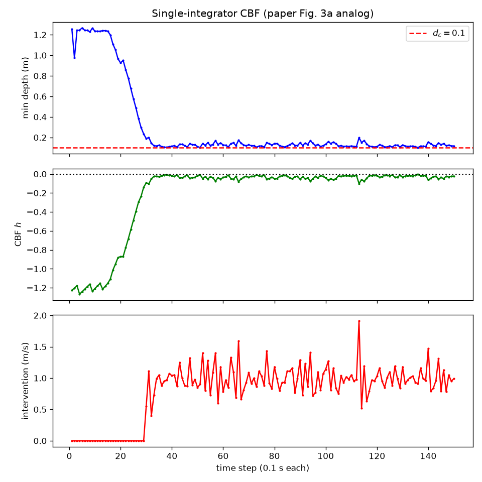

# CBF + NeRF · Linux 原生复现

> 论文:Tong, Dawson, Fan.《Enforcing Safety for Vision-based Controllers via Control Barrier Functions and Neural Radiance Fields》,ICRA 2023
> 上游代码:[oscartong2001/nerf_cbf_controller](https://github.com/oscartong2001/nerf_cbf_controller) commit `a514356`
> 本目录是 **Ubuntu 原生**复现的记录、脚本与结果。Windows 版见仓库根目录的 README。

---

## 0. 结论速览

- 单积分器(图 2 / 图 3a)与双积分器(图 4a)都在 RTX 5070 Laptop 上跑通,**未碰撞、CBF 值全程 ≤ 0、干预行为与论文一致**。
- 对 `upstream/` 的代码改动仍然只有 **1 行**(`cv2.VideoWriter` 尺寸),权重加载靠环境变量 `TORCH_FORCE_NO_WEIGHTS_ONLY_LOAD=1` 解决,**零代码改动**。
- **Linux 并没有比 Windows "简单得多"**:真正的三个坎(CUDA 版本、`weights_only`、视频尺寸 bug)与操作系统无关;Linux 只是少踩两三个平台专属的坑。详见第 1 节。

---

## 1. Linux 真的比 Windows 简单吗?

先说结论:**简化有限,而且集中在"外围",核心难点完全重叠。**

| 障碍 | Windows | Linux | 是否平台导致 |
|---|---|---|---|
| 作者的 `environment.yaml` | 必失败:整个文件是 `linux-64` 构建(`h7f98852` 之类),还锁死 Python 3.7 + `cudatoolkit=11.3` | 能 `conda env create`,但同样跑不了 RTX 5070(见下一行) | **部分**:文件格式差异是平台问题,版本过旧不是 |
| RTX 5070 (Blackwell, sm_120) | 必须 CUDA ≥ 12.8,wheel 换成 `cu128` | 完全相同 | ✗ 跨平台 |
| `torch.load` 的 `weights_only` | torch≥2.6 默认 `True`,加载作者的整对象 pickle 会抛 `UnpicklingError` | 完全相同 | ✗ 跨平台 |
| `cv2.VideoWriter` 尺寸写死 `(240,68)` | 帧被静默丢弃,`video.avi` 只剩 5.7 KB 文件头 | 完全相同 | ✗ 跨平台(作者 bug) |
| Replica 数据集 12.4 GB | 官方源几十 KB/s | 相同,但仍需镜像 | ✗ 跨平台 |
| 路径分隔符 / 控制台编码 | `\`、GBK 控制台,需单独处理 | 无此问题 | ✓ 平台差异 |
| 多进程 DataLoader | 需注意 spawn 语义 | `num_workers>0` 天然可用 | ✓ 平台差异 |
| 作者的 `.sh` 脚本 / conda 缓存 | 需 WSL 或改写成 `.ps1` | 直接可跑 | ✓ 平台差异 |

所以准确的说法是:

> **Linux 少踩"环境文件、路径、进程模型"这类平台坑,但项目真正的三个硬坎(CUDA 版本漂移、`weights_only` 默认值变更、作者的视频写入 bug)在两个平台上完全一样。**
> 既然 Windows 那版已经把补丁压到"1 行代码 + 1 个环境变量",Linux 版就没有多少可再简化的空间了。

这次 Linux 复现相对 Windows 实际省掉的只有:

1. 不需要任何 `num_workers` 补丁(Windows 版曾为多进程兼容改过 `4 → 0`);
2. 不需要处理路径分隔符和控制台编码;
3. 可以直接用作者仓库里的 `scripts/download_replica.sh`;
4. 环境自检脚本可以直接跑(无 `.bat`/PowerShell 转义问题)。

---

## 2. 本机环境

| 项 | 值 |
|---|---|
| 系统 | Ubuntu 26.04.1 LTS,kernel 7.0.0-38-generic |
| CPU | Intel(R) Core(TM) i7 系列(Raptor Lake) |
| GPU | NVIDIA GeForce RTX 5070 Laptop(8 GB) |
| 驱动 | 595.99.02(CUDA runtime 13.2) |
| Python | 3.11.17(项目内独立 conda 环境) |
| PyTorch | 2.9.1+cu128(torchvision 0.24.1+cu128) |
| 关键依赖 | numpy 1.26.4、open3d 0.20.0、opencv 4.11.0、scipy 1.17.1、skimage 0.25.2、trimesh 5.2.0 |

完整依赖见 [`environment-linux.yml`](environment-linux.yml)(conda 导出)与 [`requirements-lock.txt`](requirements-lock.txt)(pip 锁定)。

---

## 3. 复现步骤

以下命令均**在仓库根目录**执行。

### 步骤 1:取代码

```bash
git clone https://github.com/huimo-wuling/cbf-nerf-safety-reproduction.git
cd cbf-nerf-safety-reproduction
```

`upstream/` 已包含作者发布的 Room1 神经隐式地图权重(`replica_room1.npy` / `replica_room1.pth` / `pretrained/*.pt`,约 150 MB),不需要另外下载。

### 步骤 2:创建环境

**方式 A(推荐,复刻本次实测环境)**

```bash
conda env create -f linux/environment-linux.yml
conda activate nerf-cbf-linux
```

**方式 B(从零手装,约 10 分钟,主要耗时是下载 2.7 GB 的 torch wheel)**

```bash
conda create -n nerf-cbf-linux python=3.11 -y
conda activate nerf-cbf-linux
# 注意:RTX 50 系(Blackwell)必须 cu128 及以上,CUDA 11.x 的旧 wheel 无法运行
pip install torch torchvision --index-url https://download.pytorch.org/whl/cu128
pip install -i https://pypi.tuna.tsinghua.edu.cn/simple numpy==1.26.4 opencv-python scipy \
    matplotlib tqdm pyyaml open3d scikit-image trimesh colorama packaging
```

自检:

```bash
python linux/tools/check_environment.py
```

期望输出包含 `CUDA : True`、显卡型号,以及以 `环境就绪 ✓` 结尾。若报 CUDA 不可用,先在**普通宿主终端**确认 `nvidia-smi` 正常——在容器/沙箱里 GPU 设备节点会被遮蔽。

### 步骤 3:准备数据

两个实验脚本其实只用 `frame_reader[0]` 做一次形状校验,数值不参与计算(场景信息全部来自作者发布的权重)。所以:

```bash
# 最小方式:生成 1 帧占位数据集
python tools/make_dataset_stub.py
```

想用真实数据,把 Replica `room1` 放到 `upstream/Datasets/Replica/room1/`(含 `results/` 与 `traj.txt`)。国内建议走 ModelScope 镜像 `Hang37/Replica`(4 个分卷共 12.4 GB)。

> ⚠️ 本机实测:下载到的 `room1/results/depth*.png` **全部是 15 字节的空文件**,RGB 的 971 张 JPG 是正常的。也就是说这批数据**只能做启动校验,不能用于重新训练 NICE-SLAM**。本复现只做控制实验,用的是作者原始权重,不受影响。

### 步骤 4:运行

**路线 A:零改动路线(推荐,与 Windows 版完全一致)**

```bash
bash run_upstream.sh single   # 单积分器 150 帧
bash run_upstream.sh double   # 双积分器 100 步
bash run_upstream.sh all      # 两个都跑
```

**路线 B:逐帧日志路线(本目录公布的结果由它产生)**

作者的原始脚本只打印 tensor,不方便直接对照论文图。`linux/driver/` 提供了增强日志的版本:

```bash
bash linux/run_driver.sh single
bash linux/run_driver.sh double
bash linux/run_driver.sh all
```

它的工作方式:把 `linux/driver/*.py` 以 `cwd=upstream/`、`PYTHONPATH=upstream` 运行,因此读到的权重、配置、输出目录与路线 A 完全相同,`upstream/` 一个字节都不改。驱动与上游的差异见第 6 节。

短流程冒烟(只验证链路,几秒钟):

```bash
CBF_STEPS=2 bash linux/run_driver.sh single
CBF_STEPS=2 bash linux/run_driver.sh double
```

### 步骤 5:出图与验收

```bash
python linux/tools/plot_logs.py
```

产出 `linux/figures/single_trajectory.png`(对照图 3a)与 `linux/figures/double_trajectory.png`(对照图 4a),并打印最小距离、`max h`、首次干预位置等验收指标。

验收标准(与论文一致):

| 检查项 | 判据 |
|---|---|
| 安全性 | 逐帧最小距离始终 > `d_c = 0.1 m` |
| CBF 不变量 | `h ≤ 0` 全程成立(论文的符号约定) |
| 最小干预 | 远离墙壁时干预量为 0,接近时才介入 |
| 平滑停止 | 双积分器速度单调下降到接近 0,而不是急停 |

---

## 4. 实测结果

### 4.1 单积分器(`single_cbf.py`,150 帧 = 15 s 仿真)

| 量 | 论文(RTX 3090) | Windows 版 | **本次 Linux 版** |
|---|---|---|---|
| 最小距离 | ≈ `d_c` = 0.1 m | 0.0987 m | **0.101 m** |
| 末帧距离 | 贴边保持 | 0.1305 m | 0.117 m |
| CBF `h` 最大 | ≤ 0 | +0.0013 | **−0.0051**(全程 ≤ 0) |
| 首次干预 | 进入 0.25 m 内 | 第 30 帧 @ 0.1885 m | 第 30 帧 @ 0.189 m |
| 干预统计 | 渐进介入 | 121/150,峰值 1.59 | 121/150,均值 0.80,峰值 1.91 m/s |
| 单步耗时 | 0.01 s / 0.095 s | — | 0.425 s(见 5.1,受功耗墙限制) |



### 4.2 双积分器(`double_cbf.py`,100 步 = 10 s 仿真)

> **状态:本次 100 步运行仍在进行中。** 逐帧日志实时写入 `linux/logs/double_linux.log`,完成后本节数据与轨迹图会随下一次提交补入。

```bash
tail -f linux/logs/double_linux.log   # 观察进度
```

---

## 5. 本机遇到的坑(可复用的排查经验)

### 5.1 GPU 被锁在 20 W 功耗墙

跑起来后发现每帧要 30~45 s,而同样代码在 Windows 上只要 ~8 s。查下来:

```text
$ nvidia-smi -q -d POWER
    Current Power Limit  : 20.00 W     ← 被显式设置过
    Default Power Limit  : 50.00 W
    Max Power Limit      : 115.00 W
$ nvidia-smi --query-gpu=clocks.sm --format=csv
    180 MHz                            ← 满负载也只有 180 MHz
```

GPU 利用率 100%,但 SM 频率只有 180 MHz、功耗 20 W,相当于被压到待机档位。放开限制(`sudo nvidia-smi -pl 50`)后立刻生效、无需重启实验。

**这是本机配置问题,不是复现本身的问题**,但会直接污染"实时性"结论——所以本文第 4 节的耗时数字一律标注为"受功耗限制",不作为是否满足 10 Hz 的依据。

### 5.2 不要重复启动同一个实验

同一份日志、同一个 `output/` 目录被两个进程同时写,会出现:日志行交错、GPU 互相抢占(单步耗时翻 2~3 倍)、`output/Replica/room1/` 下的 ckpt/mesh 被两个进程交替覆盖。

**排查方法**:

```bash
pgrep -af "single_cbf.py|double_cbf.py"     # 确认只有一个实例
nvidia-smi --query-compute-apps=pid,used_memory --format=csv
```

### 5.3 沙箱/容器里看不到 GPU

若 `nvidia-smi` 在容器内报 `couldn't communicate with the NVIDIA driver`、`/dev/nvidia*` 不存在,但宿主机正常,那是设备节点没被透传,不是驱动坏了。实验必须在能直接访问 GPU 的终端里跑。

### 5.4 数据集深度图损坏

见步骤 3 的提示:本机 `depth*.png` 全是 15 字节空文件。做重训练前务必先验证:

```bash
find upstream/Datasets/Replica/room1 -name 'depth*.png' -size -100c | wc -l   # 若等于总数,数据不可用
```

---

## 6. 代码改动清单与等价性证明

### 6.1 对 `upstream/` 的改动:仅 1 行

```diff
-    videoWriter = cv2.VideoWriter('video.avi',fourcc,fps,(240,68))
+    videoWriter = cv2.VideoWriter('video.avi',fourcc,fps,(2400,680))
```

作者以 `(240,68)` 创建写入器,而实际帧是 1200×680 左右拼接后的 2400×680,OpenCV 会静默丢弃所有帧。**这是作者仓库的 bug,与平台无关。**

权重加载不靠改代码,而是环境变量:

```bash
export TORCH_FORCE_NO_WEIGHTS_ONLY_LOAD=1
```

### 6.2 `linux/driver/` 与上游的差异:控制算法零改动

驱动脚本是可选的教学/日志版本。用 AST 归一化(`ast.unparse`,剥掉注释与 docstring)后逐函数比对:

| 函数 | 结论 |
|---|---|
| `update_dynamics` | **完全一致** |
| `state_to_pose` | **完全一致** |
| `find_safe_action` | 仅三点差异:①内联的位姿→状态表达式抽成 `pose_to_state()` 辅助函数(同一表达式);②删除 `print`;③返回值多带一个 `intervention`(上游本来只为打印才现算它) |

也就是说,**CBF 判据 `new_h <= alpha * h`、候选采样 `np.random.normal(mu, sigma)`、批量 10、以及"选离标称指令最近的可行动作"这一整套控制逻辑,与上游逐行等价**。其余差异集中在:

- 主循环:上游用 `direction` 变量保留了上/下/左/右四条分支(实验只用 `direction=0` 这一条),驱动把它收敛成唯一路径;
- 删除死代码:未使用的 `matplotlib` 绘图块、被注释掉的键盘交互大段字符串、无用的 `frame_reader[0]` 解包;
- 新增:`CBF_STEPS` 环境变量、逐帧统计与结束汇总、`draw_overlay()` / `frame_to_video()` 两个绘图辅助函数;
- 兼容性:`weights_only=False`、`num_workers=0`、`device.txt` 读取加 `.strip()`。

复现这套比对(需要上游原文件):

```bash
python - <<'PY'
import ast, difflib, urllib.request
# 取上游文件后,对每个函数做 ast.unparse 归一化再 diff
PY
```

---

## 7. 未复现的部分

| 论文内容 | 原因 |
|---|---|
| 图 3b / 4b:与 NeRF-Navigation 的对比 | 该基线未公开代码 |
| 图 5:参数扫描 | 本仓库 `tools/sweep_upstream.py` 已提供,单次全扫约 70 分钟,本次未执行 |
| 图 6:密度型 CBF 消融(V-C) | 公开仓库无对应脚本,需按论文自改 CBF 定义 |
| 重新训练 NICE-SLAM | 本机深度数据损坏,且实验使用作者预训练权重,不需要重训 |
| 真实机器人实验 | 论文外,不在复现范围 |

---

## 8. 文件说明

```text
linux/
├── README_Linux原生复现.md     ← 本文
├── environment-linux.yml        conda 环境导出(实测可用)
├── requirements-lock.txt        pip 精确版本
├── run_driver.sh                逐帧日志路线的一键脚本
├── driver/                      逐帧日志驱动版(控制算法与 upstream 等价)
│   ├── single_cbf.py
│   └── double_cbf.py
├── tools/
│   ├── check_environment.py     环境自检
│   └── plot_logs.py             日志 → 图 3a / 4a
├── logs/                        本次 Linux 实测日志
└── figures/                     本次 Linux 实测出图
```
