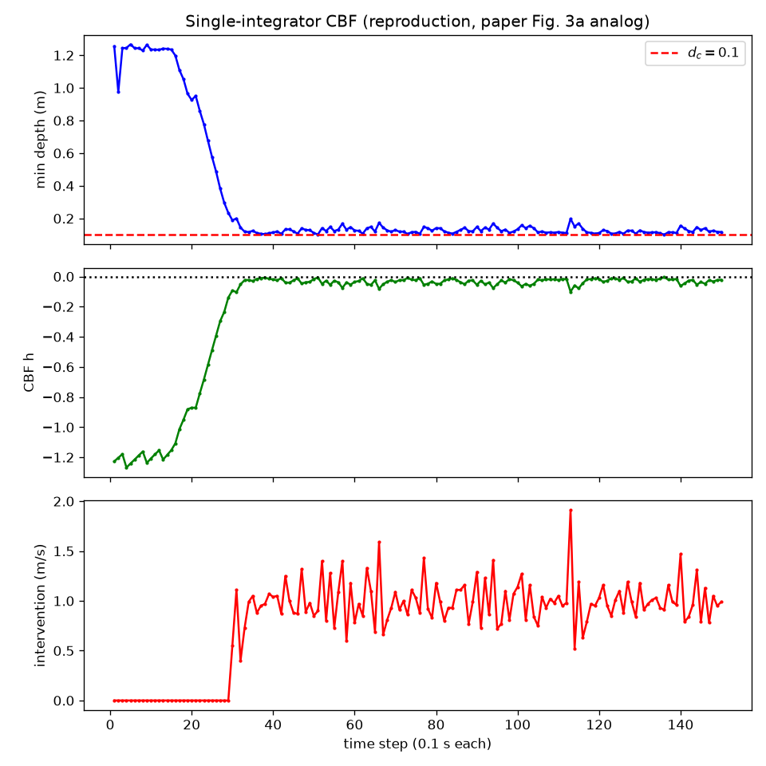
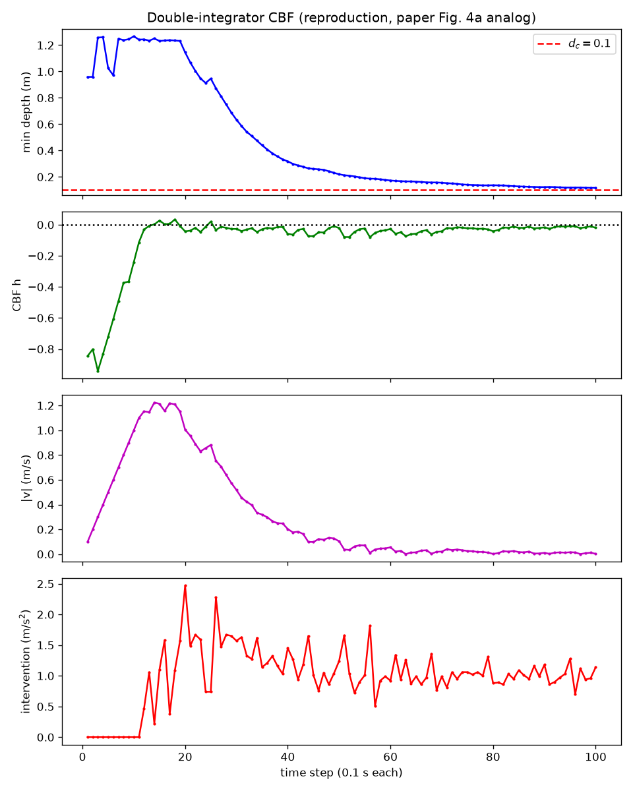

# CBF-NeRF Linux 原生移植与实测（2026-11-01）

本目录是 Ubuntu 26.04 / RTX 5070 Laptop 的独立 Linux 项目快照。**Windows 版本位于仓库根目录的原运行入口和 results/；本目录结果仅属于 Linux，不能混用。** 既有 Linux 外挂驱动方案在 [../README_Linux原生复现.md](../README_Linux原生复现.md)，本目录另存兼容补丁与中文日志版本。

来源：[作者仓库](https://github.com/oscart01/nerf_cbf_controller)，提交 `a514356c70a5cd043dff5f2767fc805e4fa74bcf`。保留 Apache-2.0 LICENSE。此版本修改了两个实验入口、旧模型加载、NumPy 别名和视频尺寸，**不属于逐字节保持上游不变的方案**。原始代码仍在仓库 `upstream/`。

## 运行

从完整仓库克隆后执行（需要 NVIDIA GPU 和兼容驱动）：

```bash
cd linux/native-port-2026-11-01
conda env create -p "$PWD/.conda" -f linux/environment-linux.yml
bash linux/prepare_assets.sh
bash linux/run.sh single
bash linux/run.sh double
```

作者权重通过相对链接复用根目录 upstream/，不重复上传。prepare_assets.sh 在不存在数据时调用仓库已有工具生成明确标注的占位帧；它仅满足 NICE-SLAM 初始化，控制实验的场景来自作者预训练模型。占位帧不能用于训练。已有数据不会覆盖；从头训练需完整有效 Replica 数据。

运行结果写入本目录 results/，重新运行会覆盖同名结果，请先备份。`CBF_STEPS=2 bash linux/run.sh double` 可做短流程检查。两个主实验分别为150帧和100步；高分辨率渲染较慢。

## 免费 PyCharm Community

用社区版打开本目录，选择已有 Conda 解释器 `.conda/bin/python`。`.run/` 中提供 `CBF single` 与 `CBF double` 配置，工作目录为本目录。IDE 安装包、个人配置和 Conda 环境本体不进入 Git；依赖版本已导出。

## 本机实测结果

| 指标 | 单积分器 | 双积分器 |
|---|---:|---:|
| 完整步数 |150|100|
| 最小展示深度 |0.101 m|0.117 m|
| 最大内部 h |-0.0051|+0.0342|
| 最终速度 |—|0.003 m/s|
| 日志平均控制耗时 |0.425 s|0.117 s|

两次均保持了0.1米展示深度间隙，双积分器表现出刹停。**双积分器内部 h 出现正值，不能声称全程满足 h≤0；两次日志平均耗时也不能支持10Hz结论。** 高低分辨率观测不一致的影响尚未做因果消融。控制逻辑沿用作者实现。

[详细验证记录](linux/验证记录.md) · [单积分器日志](results/single_cbf_log.txt) · [双积分器日志](results/double_cbf_log.txt) · [视频](results/single_cbf.avi)




日志中的本机绝对路径已替换为 `<local-project>`，实验数值未修改。依赖清单中的本机 wheel 路径已转换为版本号，并补充官方 CUDA wheel 下载源。
